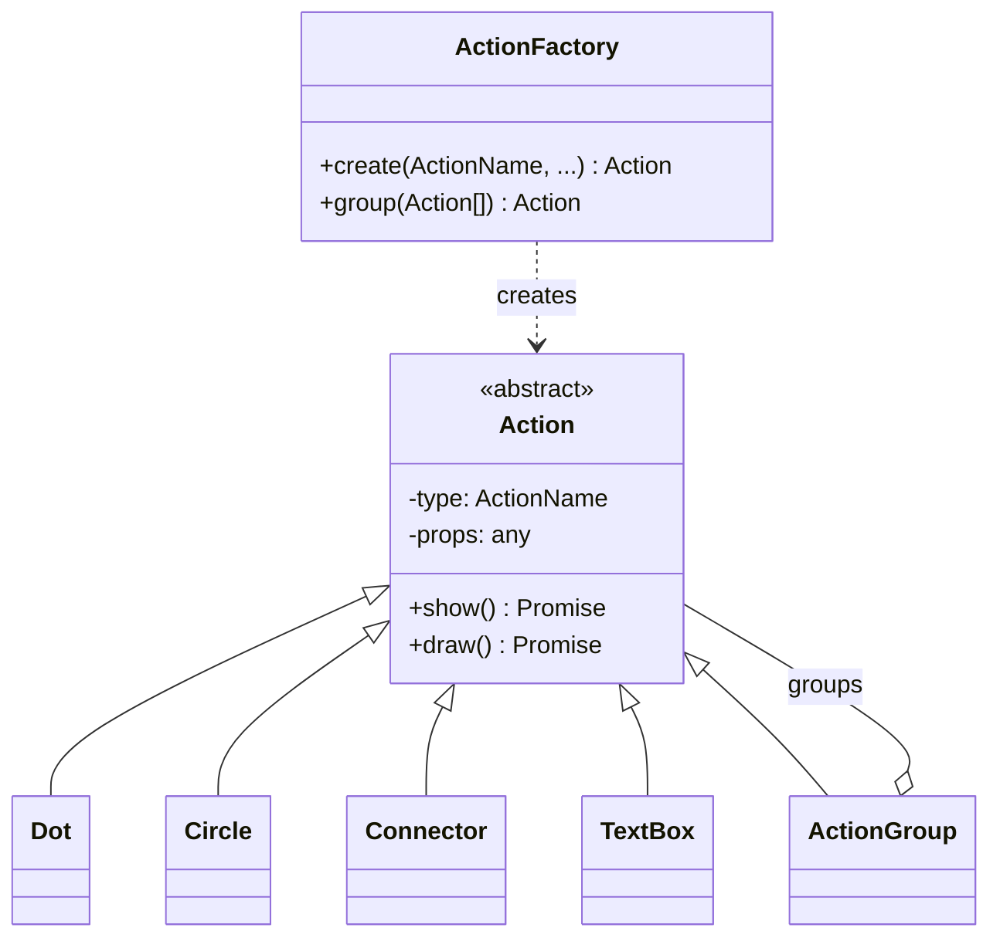

# Action API

The `Action` abstract class serves as a blueprint for defining atomic actions, e.g., circles, dots, etc. represented by `Circle` and `Dot` classes respectively.



*Action classes. Please see the source code for all classes, their methods and attributes.*

## Action names

Various actions are defined as enumerators, e.g.,

```ts
export enum ActionName {
  DOT = "DOT",
  CIRCLE = "CIRCLE",
  TEXT_BOX = "TEXT_BOX",
  CONNECTOR = "CONNECTOR",
  ...
}
```

## Creating MSB actions

Instantiate a `Circle` action object and display it within an SVG canvas. The default action properties are used unless defined in the feature-action table.

```ts
new Circle()
    .setProps(<props>)
    .setCanvas(<svg>)
    .setCoordinate(<coordinates>)
    .show();
```

Animated movement for objects, e.g., `TextBox`, can be achieved by:

```ts
new TextBox()
    .setProps(...)
    .setCanvas(...)
    .setCoordinate(...)
    .show()
    .move(<coordinates>, ...);
```

## Grouping actions

The `ActionGroup` class employs a composite design pattern to group multiple actions representing a feature, as shown in an example below:

```ts
new ActionGroup()
    .group(<actions>)
    .setCanvas(...)
    .setCoordinate(...)
    .show();
```

## ActionFactory

The `ActionFactory` utilizes a factory design pattern to simplify the creation of action objects, making it more efficient to generate actions from feature-action tables.

```js
new ActionFactory()
    .create(<action name>, <action properties>)
```
