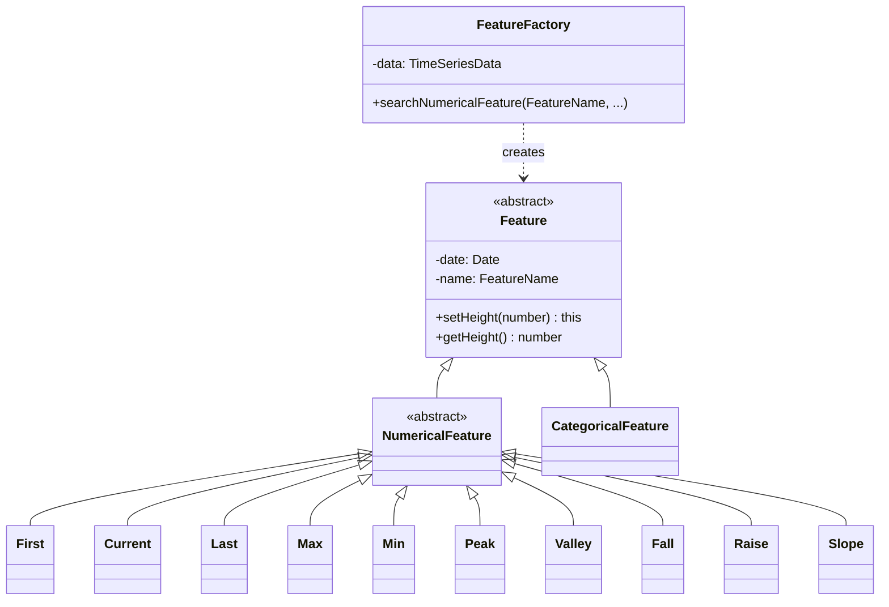

# Feature API

The `Feature` is an abstract class that encapsulates both numerical and semantic attributes of time series data through its subclasses, `NumericalFeature` and `CategoricalFeature`. These base classes serve as the foundation for concrete classes such as `Peak`, `Min`, `Max`, etc., providing a structured approach to define features of time series data. Developers can extend this base class to implement new features.



*The class diagram of the MSB feature classes. Please see the source code for all classes, their methods and attributes.*

## Feature names

Features are defined as enumerators, e.g.,

```ts
export enum NumericalFeatureName {
  FIRST = "FIRST",
  CURRENT = "CURRENT",
  LAST = "LAST",
  MAX = "MAX",
  MIN = "MIN",
  PEAK = "PEAK",
  VALLEY = "VALLEY",
  FALL = "FALL",
  RAISE = "RAISE",
  SLOPE = "SLOPE",
  ...
}
```

## Creating an MSB feature

To instantiate a feature, use the constructor of a concrete feature class. Set properties using method chaining. For example, when a feature `PEAK` is detected it creates a `Peak` object as follows. The default feature properties are used unless defined in the feature-action table. Use the getter functions to retrieve the feature properties.

```ts
new Peak()
    .setDate(...)
    .setHeight(...)
    .setNormWidth(...)
    .setNormHeight(...)
    .setRank(...)
    .setMetric(...)
    .setStart(...)
    .setEnd(...)
    .setDataIndex(...);
```

## FeatureFactory

The `FeatureFactory` class implements a factory design pattern for streamlined feature creation, utilizing search functions to dynamically generate feature instances based on input feature-action table and time series data.

```js
new FeatureFactory()
    .setProps()
    .setData()
    .searchNumericalFeatures(<feature name>, <properties>, ...);
```
