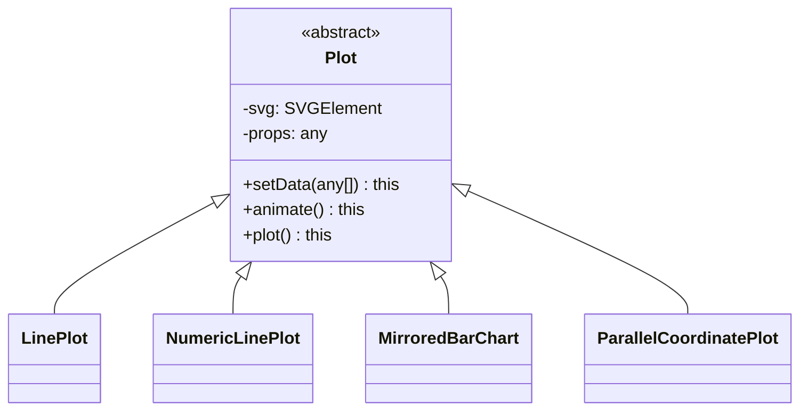

# Animated Plots API

`Plot` is an abstract class that defines abstract methods used for creating a plot, setting properties, and animating. The concrete plots, e.g., line plot, and parallel coordinate plots implement the actual logic.



*Plot classes.*

## Creating a plot

Create a line plot and animate actions,

```ts
new LinePlot()
    .setData(<time series data>)
    .setName(<selected data stream name>)
    .setProps(<props>)
    .setPlotProps(<plot props>)
    .setCanvas(<svg>)
    .setActions(<actions>)
    .animate()
```

## Animation controllers

Animation is driven by controllers in `src/components/animation`:

- `PlayPauseController` — play/pause a single plot's timeline.
- `SyncPlotsController` — keep multiple plots animating in sync.

A React hook is shipped as an optional entry point:

```ts
import { useControllerWithState } from 'meta-storyboard/react';

const [controller, isPlaying] = useControllerWithState(msb.PlayPauseController, [plot]);
```
