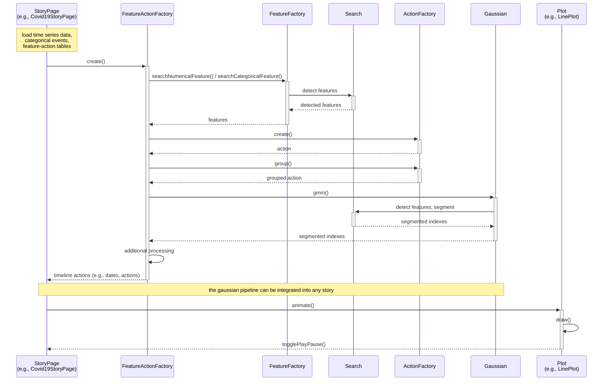

# Story Creation Workflow

The sequence diagram below demonstrates a story creation process and the important classes and methods involved. A story page (e.g., the COVID-19 story) loads the data and feature-action tables, delegates feature detection and action creation to `FeatureActionFactory`, and finally hands the resulting timeline actions to a plot for animation.

*Sequence diagram demonstrating a story creation process and important classes and methods involved.*
